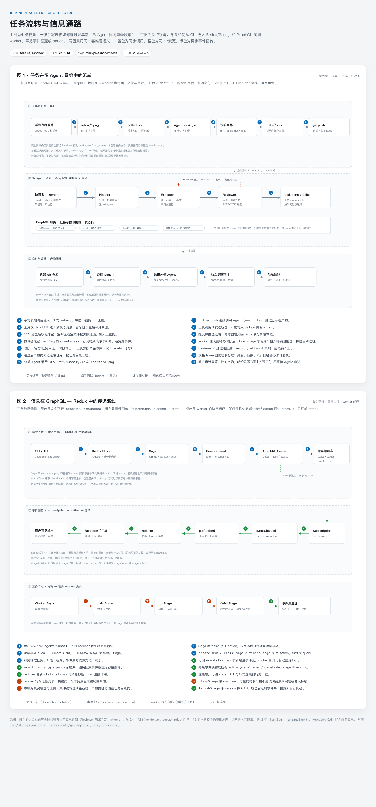

# Mini Pi 项目组

一个最小可用的多 Agent 运行时，以及它跑通的第一条端到端数据流水线。



> 主页：https://math4mad.github.io/mini-pi/ · 选题：Redux/Saga 驱动的 Agent 状态机、GraphQL 多机协同、docker 执行沙箱

## 仓库

| 仓库 | 职责 | 当前分支 / 状态 |
| --- | --- | --- |
| [Mini-Pi-Agents](https://github.com/math4mad/Mini-Pi-Agents) | Agent 运行时：Redux + Redux-Saga 状态机、Planner → Executor → Reviewer 流水线、GraphQL 多机协同、执行沙箱 | `feature/sandbox` |
| [mini-pi-data-live](https://github.com/math4mad/mini-pi-data-live) | 实战流水线：手写表格拍照 → OCR 成 CSV → 推送仓库 → 数据分析与可视化 → 独立复算审计 | `main` |

## 系统一览

- **单机模式**：`Planner → Executor → Reviewer`，Reviewer 不通过自动返工（上限 2 次）
- **多机协同**：GraphQL 控制面负责任务/阶段状态，worker 以 10 分钟租约认领阶段，提交带 `version` CAS 与 `clientEventId` 幂等；订阅按 `seq` 断线补齐
- **执行沙箱**：docker / host 两种 backend，默认 fail closed；容器内非 root、只读根文件系统、无网络、pids / 内存 / CPU 限额，`write_file` 限定任务目录
- **语言镜像**：`mini-pi-sandbox:node` / `data`（pandas + matplotlib）/ `r` / `julia`
- **多模态**：图片以 data URL 透传到首个阶段，支持手写表格识别

## 当前进展（2026-11-12）

- 沙箱回归：本机 Docker Desktop 与 m1（colima + VZ）均 95/95 测试通过
- 手工补验：容器内 kill 宿主进程无效（PID 隔离）、fork 炸弹被 pids-limit 限制、宿主无残留
- 实战闭环：m1 拍照识别 → CSV → 推送 → 分析 Agent → 独立复算审计通过
- 下一步：P1 Agent 能力注册表 → P2 阶段产出验收 → P3 入料闸门

## 快速开始

```bash
# Agent 运行时（需要 Node >= 22.19）
git clone git@github.com:math4mad/Mini-Pi-Agents.git
cd Mini-Pi-Agents && npm install
npm run agent -- "用 TypeScript 写一个 LRU 缓存并补测试"

# 构建沙箱镜像
docker build -f docker/sandbox-node.Dockerfile -t mini-pi-sandbox:node .
docker build -f docker/sandbox-data.Dockerfile -t mini-pi-sandbox:data .
```

## 架构图

- [index.html](index.html)：图 1 任务全链路流转、图 2 GraphQL ↔ Redux 信息通路（自包含，可直接打印）
- 源文件位于 `Mini-Pi-Agents/docs/agent-flow.html`
